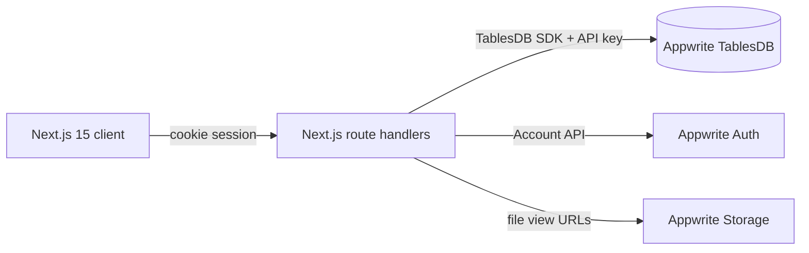

# CivicPulse

**Hyperlocal civic issue tracker — report, de-duplicate, and track local problems.**

Built for the **Appwrite Hackathon (Oct 2026)**. CivicPulse runs on a single Appwrite
**TablesDB** database: issues, upvotes and status events are tables/rows, authentication is
Appwrite Auth, and photos live in Appwrite Storage.


## Demo video

[](https://youtu.be/OaSJ52U3QO0?si=02GpgLXkHWBHp4m5)

Watch the full demo: [CivicPulse Demo Video](https://youtu.be/OaSJ52U3QO0?si=02GpgLXkHWBHp4m5)

---

## What it does

1. **Report an issue** — category, title, description, priority, GPS coordinates (browser
   geolocation), optional photo reference.
2. **Duplicate detection while typing** — the form asks the API for similar nearby issues and
   offers to upvote an existing report instead of adding a duplicate.
3. **Nearby feed** — radius search (0.1–50 km) with category/status filters and sorting by
   recency, upvotes or distance.
4. **"Me too" upvotes** — one vote per user per issue, enforced by a unique index; the counter
   is updated with TablesDB `incrementRowColumn` / `decrementRowColumn`, so concurrent votes
   cannot clobber each other.
5. **Status lifecycle** — `reported → acknowledged → in_progress → resolved`, admin-only, with
   an append-only timeline of status events.
6. **Public stats** — totals, resolution rate, average resolution time and a per-category
   breakdown.
7. **Admin dashboard** — searchable/filterable issue table, inline status changes, delete.

---

## Architecture



- **Data layer:** `lib/issues-service.ts` is the only place that talks to TablesDB. Route
  handlers stay thin (validate → call service → shape response).
- **No SQL, no dual writes.** One database, one source of truth.
- **Geospatial without PostGIS:** TablesDB has no spatial index, so the radius/similarity
  endpoints page through candidate rows (up to 500) and compute haversine distance in process.
  This is deliberate — town-scale volumes make it instant, and it keeps the stack to one store.
- **Duplicate detection without pg_trgm:** a Dice coefficient over stop-worded title and
  description tokens, combined with a radius filter.

### Auth flow

Appwrite's browser SDK writes its session cookie on the **Appwrite domain**, which a Next.js
route handler can never read. So authentication is server-side:

1. `POST /api/auth/login` (or `/signup`) creates the Appwrite session with the server SDK and
   reads `session.secret` (returned because the request is authenticated with the API key).
2. The secret is mirrored into a first-party, HttpOnly `a_session_<projectId>` cookie.
3. `lib/auth-server.ts` resolves that cookie to a user by calling `Account.get()` with
   `client.setSession(secret)`, giving every API route a real, verified user.
4. Admin access = the Appwrite user label `admin` **or** an email listed in `ADMIN_EMAILS`.

---

## TablesDB schema

Column keys are camelCase, matching the tables in the Appwrite console.

### `issues`

| Column | Type | Notes |
|---|---|---|
| `title` | text | required |
| `description` | text | required |
| `category` | text / enum | `pothole`, `water`, `power`, `garbage`, `streetlight`, `drainage`, `road`, `other` |
| `status` | text / enum | `reported`, `acknowledged`, `in_progress`, `resolved` |
| `priority` | text / enum | `low`, `medium`, `high`, `urgent` |
| `latitude` | double | required, −90…90 |
| `longitude` | double | required, −180…180 |
| `address` | text | optional |
| `imageUrl` | text | optional — Appwrite file ID or absolute URL |
| `userId` | text | Appwrite user ID |
| `userName` | text | optional |
| `userEmail` | email | optional |
| `upvoteCount` | integer | min 0, updated atomically |
| `resolvedAt` | datetime | set when status becomes `resolved` |

Indexes: `status`, `category`, `userId`.

### `upvotes`

| Column | Type | Notes |
|---|---|---|
| `issueId` | text | required |
| `userId` | text | required |

Unique index on `(issueId, userId)` — one vote per user per issue.

### `status_events` (append-only audit trail)

| Column | Type | Notes |
|---|---|---|
| `issueId` | text | required |
| `oldStatus` | text / enum | optional |
| `newStatus` | text / enum | required |
| `changedBy` | text | user ID of the admin |
| `note` | text | optional |

Index: `issueId`.

---

## Setup

### 1. Install

```bash
npm install
cp .env.example .env
```

### 2. Create the Appwrite resources

In the Appwrite console create a project, a **TablesDB** database, three tables
(`issues`, `upvotes`, `status_events`) and a Storage bucket for photos, then create an API key
with the `databases`, `tables`, `columns`, `rows`, `files` and `users` read/write scopes.

Fill `.env` with the project ID, database ID, table IDs, bucket ID and API key.

### 3. Provision + seed from the CLI

The setup script is idempotent — it inspects the schema, creates anything missing, and can load
demo data around Ludhiana.

```bash
npm run appwrite:inspect   # list tables, columns and row counts
npm run appwrite:setup     # create missing columns, indexes and the storage bucket
npm run appwrite:seed      # add 12 demo issues + status events (--force to add again)
```

### 4. Run

```bash
npm run dev      # http://localhost:3000
npm run build && npm run start
```

### Demo login

Sign up through the UI, or create the demo account by calling the signup endpoint once:

```bash
curl -X POST http://localhost:3000/api/auth/signup \
  -H 'Content-Type: application/json' \
  -d '{"name":"Demo Resident","email":"demo@civicpulse.in","password":"demo1234"}'
```

Add that email to `ADMIN_EMAILS` to get admin rights (status changes, deletes, `/admin`).

---

## API

| Method | Route | Auth | Purpose |
|---|---|---|---|
| `GET` | `/api/issues` | public | Paginated list (`status`, `category`, `limit`, `offset`) |
| `POST` | `/api/issues/create` | user | Create an issue (rate limited 5/hour) |
| `GET` | `/api/issues/:id` | public | Issue + status timeline |
| `DELETE` | `/api/issues/:id` | admin | Delete an issue |
| `PATCH` | `/api/issues/:id/status` | admin | Change status (writes a status event) |
| `POST` | `/api/issues/upvote` | user | Toggle the current user's upvote |
| `GET` | `/api/issues/upvote?issue_id=` | public | Has the current user upvoted |
| `GET` | `/api/issues/nearby` | public | Radius feed (`latitude`, `longitude`, `radius_km`, `category`, `status`, `sort_by`) |
| `POST` | `/api/issues/similar` | public | Duplicate candidates (`title`, `description`, `latitude`, `longitude`, `radius_km`) |
| `GET` | `/api/stats` | public | Totals + per-category stats |
| `GET` | `/api/admin/issues` | admin | Admin list with search |
| `GET` | `/api/admin/stats` | admin | Dashboard stats |
| `POST` | `/api/auth/signup` · `/login` · `/logout` | public | Session management |
| `GET` | `/api/auth/session` | public | Current user |

---

## Project structure

```
app/
├── api/
│   ├── auth/{login,signup,logout,session}/route.ts
│   ├── admin/{issues,stats}/route.ts
│   ├── issues/route.ts                 # list
│   ├── issues/create/route.ts
│   ├── issues/[id]/route.ts            # GET / DELETE
│   ├── issues/[id]/status/route.ts     # admin PATCH
│   ├── issues/{nearby,similar,upvote}/route.ts
│   └── stats/route.ts
├── admin/{page.tsx,issues/page.tsx}
├── auth/{page.tsx,login/page.tsx,signup/page.tsx}
├── issues/{page.tsx,new/page.tsx,[id]/page.tsx}
├── stats/page.tsx
├── layout.tsx
└── page.tsx
components/        # UI primitives + IssueCard
lib/
├── appwrite.ts            # browser client (realtime-ready)
├── appwrite-server.ts     # server client + TablesDB
├── auth-server.ts         # session cookie → SessionUser, requireUser / requireAdmin
├── issues-service.ts      # all TablesDB reads/writes, geo + text matching
├── validation-simple.ts   # request validation
├── rate-limit-simple.ts   # in-memory rate limiting
├── api-response.ts        # error mapping
└── auth.ts                # client-side auth helpers
scripts/setup-appwrite.mjs # inspect / provision / seed
types/index.ts             # domain types
```

---

## Notes and limitations

- **Rate limiting** is in-memory (`lib/rate-limit-simple.ts`); on multi-instance hosting swap it
  for Upstash/Redis.
- **Radius and similarity search** scan up to 500 rows per request. Fine for a town; a
  geohash column would be the next step at larger scale.
- **Photo upload UI** is not wired yet: the API accepts `photo_id` / `imageUrl` and the bucket is
  provisioned, but the report form currently submits text and location only.
- **Realtime** subscriptions are not used; the feed refreshes on navigation. `lib/appwrite.ts`
  is the browser client that a realtime channel would attach to.
- No map tiles yet — locations are stored and shown as distance/coordinates.

## License

MIT
